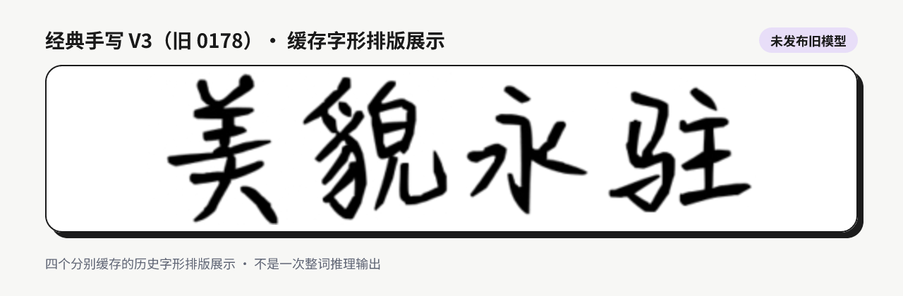
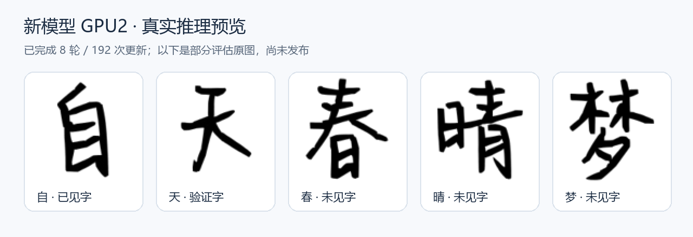
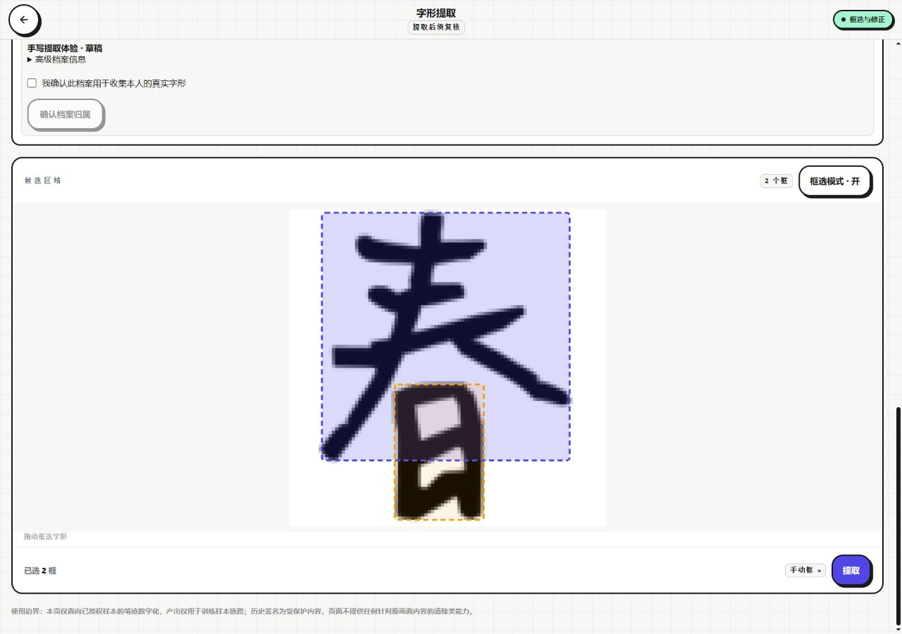
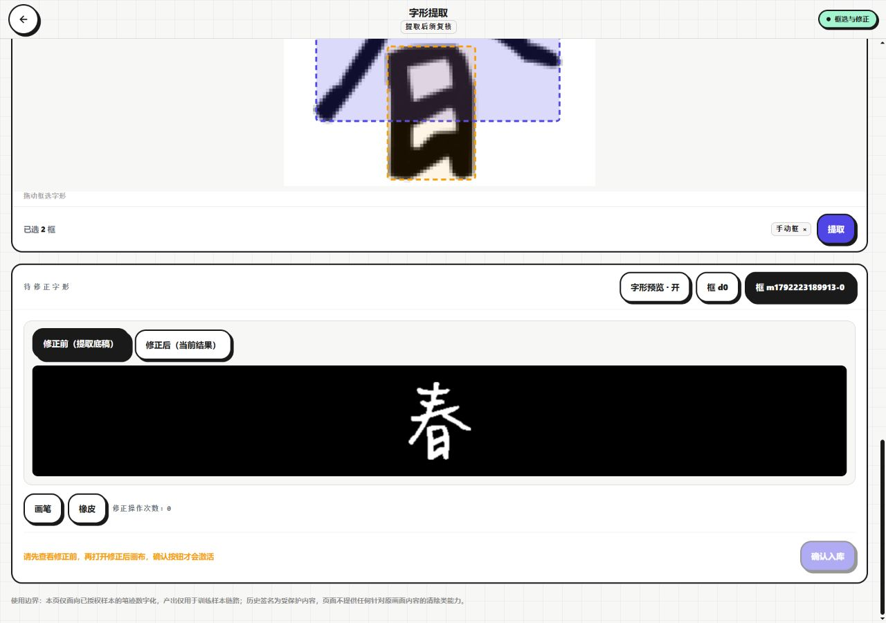
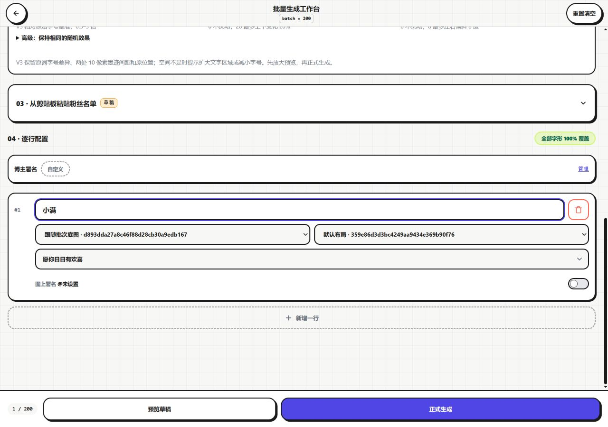
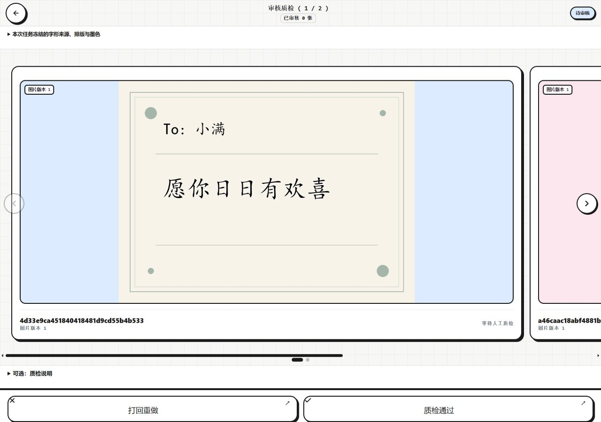
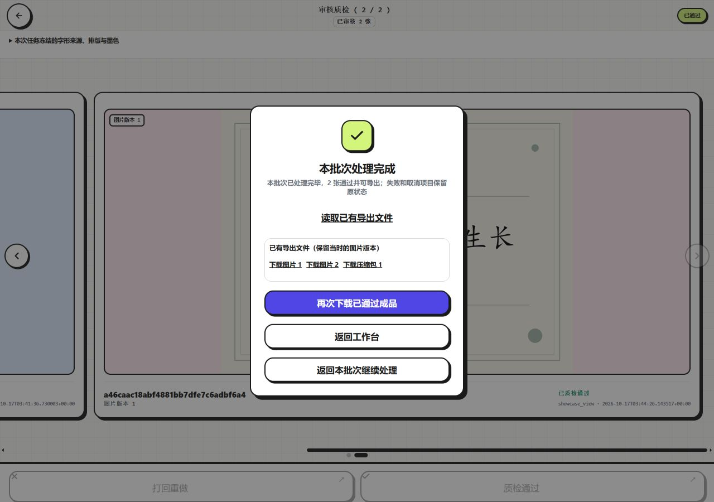
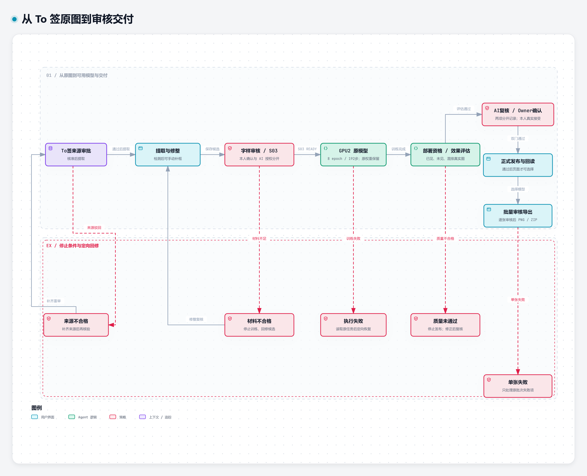

<h1 align="center">ToSign Studio</h1>

<p align="center">从 To 签参考图中提取笔迹，训练个人手写字体，再批量制作带姓名与祝福的签图。</p>


给签图创作者的一套本地工作台：把散落在参考图里的手写字整理成训练材料，让个人笔迹进入可追溯的模型，再用于重复出图。它把**字形提取与修整、字体训练与评估、批量排版、逐张质检、PNG/ZIP 交付**连在一起，适合积累个人风格的创作者和需要制作多人签图的小团队。

当前是开发预览版：经典手写 V3 已有真实生成记录；新 GPU2 模型已训练完成并产出部分评估字形，**完整质量审核与正式发布尚未完成**。开源包不包含私人模型、训练集或执行密钥；第一次安装可先用系统字体走通制作与导出。

## 页内索引

[真实手写效果](#handwriting) · [前端怎么用](#screens) · [训练与出图流程](#workflow) · [功能边界](#features) · [安装与首次使用](#start) · [页面入口](#use) · [系统架构](#architecture) · [技术与设计](#engineering) · [故障与限制](#limits) · [许可证](#license)

<a name="handwriting"></a>
## 先看真实的手写结果

### 经典手写 V3：已有模型的真实笔迹



“美、貌、永、驻”均取自旧 0178 模型的独立 20 步推理缓存。这里将原始透明字形放在一起，便于看清笔画与风格；**不是系统字体，不是一次整词推理，也不是 GPU2 新模型的成果**。旧模型已有特定文案出图与导出记录，但不能据此承诺所有冷字或任意文案都可靠。

### GPU2：本项目训练出的新模型



这五张字形来自同一份 **8 轮、192 次更新**的 GPU2 权重，在 CUDA 上进行真实推理，分别覆盖已见字、验证字和未见字。展示保留原生 96×96 图像的笔画，仅放大排版，没有用系统字体替代或重绘笔迹。

[查看原生单字图像与来源](assets/handwriting/README.md)。

这些是**未完成评估中的真实预览**，可以直接观察到分辨率与笔画形态的限制。完整评估曾中断，AI 质量审核、本人必要确认和正式发布尚未通过；不能把训练结束、单字可辨或这张展示板当成新模型已经可在页面使用的证明。

<a name="screens"></a>
## 从提取笔迹到交付，页面里能做什么

以下均为当前前端真实运行截图，没有拼造按钮或成功状态。为保护私人照片与账号，使用独立实例、原创几何底图；批量出图使用系统字体，**这里只展示页面操作，不冒充手写训练结果**。提取页输入是上方历史 GPU2“春”字预览，用来实际操作提取工具，不是新训练材料入库记录。

### 1. 找到字形，自动框不准时自己补框

在原图的文字提取入口选择候选区域，也可以手动框选完整字形。自动识别可能把一个字拆成几块，因此先看框，再提取。



### 2. 检查笔画，修整后再进入正式样本审核

提取底稿支持修正前后对照、画笔与橡皮擦。字符是什么、笔画是否完整，仍需要实际审核；点过提取并不等于已经得到合格训练数据。



### 3. 把底图、版式、名单与祝福组合成任务

为姓名、文案和署名设置不同区域，选择已可用的字形来源，再输入名单。已有模型需要匹配其实际执行条件；没有模型时可以使用系统字体体验排版与交付。中文、英文、数字和标点的来源可区分，避免把字体回退误当成个人模型结果。



### 4. 看实际图片，再决定通过或重做

生成完成后逐张查看具体版本；失败项保留原记录，可定向恢复。任务还在运行时显示状态，不能把占位图当成成品。通过的质检只属于当前图片版本。



### 5. 单张 PNG 或整批 ZIP，输出与审核一致



本次独立实例确实完成两张生成、明确标注的 AI 界面测试质检、两张 PNG 与整批 ZIP 导出，并逐字节核对 ZIP 成员与 PNG 一致。这个结论只覆盖系统字体页面链路，不代表真人审美验收或 GPU2 发布通过。

<a name="workflow"></a>
## 两条相连的工作流

### 先让个人笔迹成为可用模型

训练材料来自 To 签参考图的文字提取：原图保留，字形修整后进行正式审核，固定成 S03 数据快照，再训练、评估和发布。**训练完成与发布可用是两个阶段**；效果不合格需回到材料或评估环节，而不是改一个数据库标志。



新模型必须经过真实已见字、未见字及必要混排效果检查，再完成规定的 AI 与本人确认。当前 GPU2 停在效果评估与发布之前，不需要重复训练已有权重。可选：[交互训练流程](assets/diagrams/training-workflow.html) · [可编辑源](assets/diagrams/training-workflow.json)。

### 再把可用字形变成可交付签图


底图通过审核 → 保存对应版式 → 选择可用模型或系统字体 → 填写名单 → 生成 → 逐张质检 → 导出。提交响应不明时先查回任务，失败只恢复相应项；取消也需要确认最终状态。可选：[交互出图流程](assets/diagrams/workflow.html) · [可编辑源](assets/diagrams/workflow.json)。

<a name="features"></a>
## 已实现的能力与验证范围

| 你要解决的问题 | 可以做什么 | 当前范围 |
|---|---|---|
| 喜欢的笔迹散落在签图里 | 从参考图框选、提取、修整字形，保留原图与来源 | 提取/修整页面已实测；语义和完整性仍需正式审核 |
| 想积累自己的手写风格 | 管理样本、固定 S03、训练并查看评估与发布状态 | GPU2 完成训练并有真实输出；完整发布未验收 |
| 同一底图要做给很多人 | 保存文字区域，输入不同姓名、祝福与署名 | 系统字体两项真实页面生成通过；接口最多接受 200 项，不是吞吐承诺 |
| 不同文字需要不同来源 | 区分中文模型、英文字体、数字与标点，记录任务实际使用的来源 | 经典 V3 组合为旧中文模型、Caveat 600、Noto face 2；准确资产需另备 |
| 担心错图、漏审和重复提交 | 查看逐项状态、版本质检、失败恢复、取消及幂等查回 | 独立数据实例验证审核门、幂等与重启保持；冷字性能仍有风险 |
| 要一次交付成品 | 下载单张 PNG 或已审核成品 ZIP | 两项页面导出与 ZIP 字节一致已核对 |
| 希望常用资料可复用 | 祝福语预设、素材整理、账户隔离、用量与审计 | 源码已有入口；备份与全部管理场景未在本轮完整验收 |

它适合“积累笔迹 → 形成风格 → 重复出图”的工作，而自由绘画、任意照片修复或通用 OCR 不是它的替代目标。来源、任务和审核随成品保留，重做后不能沿用旧版本的审核。

<a name="start"></a>
## 快速开始：先跑系统字体生成

本源码包提供不含私人资产的开发体验。以下步骤在 **Windows、E 盘、Python 3.12.13、Node.js 24.18.0、npm 11.16.0** 上验证；其他系统未验证。准备 Python 3.12；Node.js 的声明范围是 `^20.19.0 || ^22.12.0 || >=24.0.0`，首次体验建议使用上面的实测版本。安装需要访问 Python/npm 软件源。

系统字体演示还需要本机已有 `Windows/Fonts/simkai.ttf`（楷体）。字体文件不随包分发；缺少它时不要把其他字体伪装成这次的演示效果。首次体验不需要 PyTorch、CUDA 或模型权重。

### 1. 安装并构建

将源码解压到 E 盘，打开 PowerShell，**进入解压后的项目根目录**。以下命令都从该目录执行；所有数据使用新建目录。

```powershell
py -3.12 -m venv .venv
$python = (Resolve-Path .venv/Scripts/python.exe).Path
& $python -m pip install -r requirements-base-app.lock
npm --prefix frontend ci
npm --prefix frontend run build
```

预期：Python 依赖安装成功，前端类型检查通过，生成 `frontend/dist/index.html`。源码不含预装依赖或构建目录。若使用离线依赖，必须匹配锁文件；不能用已有依赖目录代替一次全新安装验证。

### 2. 先做一次可复现的生成与导出

```powershell
$demo = Join-Path (Get-Location).Path 'demo-output'
& $python showcase/demo.py --output $demo --port 18916
```

`demo-output` 必须不存在或为空，端口必须空闲。程序会创建独立数据库、一次性邀请码和随机测试账户，启动本地服务，用两条名单生成图片，检查审核门、导出与重启恢复，然后关闭自己的服务。它不会使用现有用户数据，也不执行 GPU 训练。

预期看到 **20 checks passed**，并得到：

- `demo-output/base-original.png`：原创底图。
- `demo-output/render-1.png`、`render-2.png`：两张实际生成图片。
- `demo-output/outputs.zip`：包含与成品字节一致的两个 PNG。
- `demo-output/result.json`：本次检查项目和输出摘要。

重复演示时选择另一个空目录，保留上一次结果。

### 3. 启动自己的页面工作台

继续在同一个 PowerShell、同一个项目目录执行。下面是另一套新数据，不复用自动演示账号。

```powershell
$data = Join-Path (Get-Location).Path 'local-data'
$env:YY_DB_URL = 'sqlite:///' + (Join-Path $data 'studio.db').Replace('\', '/')
$env:YY_STORAGE_ROOT = Join-Path $data 'storage'
& $python showcase/serve.py --init-data
& $python installer/first_invite.py FIRST-RUN --uses 1 --yes
& $python showcase/serve.py --port 18916
```

必须先执行 `--init-data`，再创建邀请码；启动器会拒绝接管未登记的非空数据库或素材目录。`FIRST-RUN` 仅用于这个本地新实例的一次注册，不是通用账号密码。

打开 [本机注册页面](http://127.0.0.1:18916/register)，自己设置账户和密码，使用刚创建的邀请码注册。首个账户是本实例管理员，首次登录需修改密码，再进入工作台。关闭服务用当前终端的 `Ctrl+C`；下次使用相同两个数据路径直接启动，无须重建邀请码或数据库。启动器固定只监听本机回环地址。

### 4. 运行验证

```powershell
& $python -m pip install -r requirements-verification.txt
& $python -m pytest tests/showcase -q
```

默认执行启动与数据保护测试，完整 API 演示测试默认跳过。构建完成后，可显式启用它：

```powershell
$env:YY_SHOWCASE_E2E = '1'
& $python -m pytest tests/showcase -q --basetemp test-output
Remove-Item Env:YY_SHOWCASE_E2E
```

`test-output` 应为新测试目录，不要指向用户数据。测试通过不代表私人手写模型已经发布。

<a name="use"></a>
## 页面入口与第一次操作

1. 在 `/assets` 上传有权使用的底图，通过管理员审核后，进入标注页保存分开的姓名、文案区域。
2. 在 `/batch` 选择底图与对应模板。干净安装先选“系统字体”，填写短姓名与祝福语，预览后正式生成。
3. 在审核页查看真实成品，核对文字、位置与笔画，质检通过后导出 PNG；多项通过后导出 ZIP。
4. 要积累手写材料，从参考图进入字形提取，修整后进入 `/training` 的正式样本审核。不要用上传数量替代合格字符数量。
5. 有合格执行环境时再准备 S03、训练和效果评估。只有完成必需审核与正式发布的模型，才可作为新模型供生成选择。

`/styles` 管理字体与风格，`/blessings` 管理祝福语，`/me` 是个人设置；审计和备份入口需要管理员权限。源码包没有预置可公开分发的个人模型，所以首次启动不会自动出现已发布 GPU2。

可复现的安装烟测使用下面的系统字体成品。它用于确认依赖、排版、审核与导出是否工作，与前面的手写效果明确区分：


另一项“清和 / 平安喜乐 自在生长”也由同一真实 API 生成：[查看第二张 PNG](assets/demo/signature-2.png)。[空白底图](assets/demo/background.png)可用于自己的首次页面操作。

<a name="architecture"></a>
## 系统怎样运行

### 使用者与系统边界


用户通过本地浏览器操作。素材、任务和输出保存在本地；可选模型与字体必须单独具备合法来源和执行条件。下方运行单元图中的可选模型路径不表示源码包自带已发布模型。

### 页面、服务与存储


这是一个**本地模块化单体**：Vue 页面通过 HTTP 调用同一 FastAPI 应用，各业务域在该进程内协作。SQLAlchemy/SQLite 保存账户、任务、审核与文件索引；本地文件保存原图、字形、快照和输出。生成等工作由进程内后台线程处理，较重的个人模型任务使用独立 Python 子进程及资源租约。浏览器不直接访问数据库。

首次体验启动器将前端构建与 API 放在同一端口，明确禁用个人训练 worker；配置中的 GPU 锁路径仅满足源码导入时的资源配置检查，不创建锁、不授权模型执行。这里没有 Redis、Celery 或独立消息队列服务。

可选交互视图：[系统边界](assets/diagrams/context.html)、[运行单元](assets/diagrams/containers.html)。
可编辑与语义源：[Context JSON](assets/diagrams/context.json)、[Container JSON](assets/diagrams/containers.json)、[完整图形参考](docs/architecture/index.md)。核心关系已在本页展开，无须打开参考页才能理解。

<a name="engineering"></a>
## 技术选型与关键设计

| 技术 | 在这个项目中的职责 |
|---|---|
| Vue 3、TypeScript、Vue Router、Pinia | 图库、标注、训练、批量、审核页面；路由权限与会话状态 |
| Vite、Tailwind CSS | 前端构建、样式与工作台视觉 |
| FastAPI、Pydantic、Uvicorn | HTTP 接口、请求校验、登录与本地服务 |
| SQLAlchemy、SQLite | 账户归属、素材索引、任务/审核状态和恢复记录 |
| Pillow、NumPy、fontTools | 图片处理、颜色/字形处理、字体覆盖与排版 |
| 可选 PyTorch、CUDA、FontDiffuser 适配 | 个人手写风格的训练与推理；不参与系统字体首次体验 |
| pytest、Vitest | 后端/集成辅助测试与前端行为测试；当前安装验证范围见上文 |

**可查回的任务。** 创建请求支持幂等键，遇到响应中断先读取任务，减少重复生成。失败项可保留原版本并单独恢复。任务创建时冻结重要输入，不能把后改的风格冒充原任务。

**审核针对具体成品。** 状态、图片版本与字节身份共同参与导出判断；文件变动或版本重做不能继承旧通过。下载再次核对导出文件，ZIP 并非随意打包磁盘目录。

**字形来源可区分。** 系统字体、导入的旧个人模型和新训练模型各有身份；中文、拉丁字母、数字及标点可分别指定来源。经典手写 V3 的组合包含旧中文模型、Caveat 600 与 Noto face 2；它依赖包外的准确字体/模型及独立执行资格。不能因回退到系统字体就宣称个人风格推理成功。

**训练数据有绑定。** S03 是固定训练数据快照；模型与数据、源码及执行环境分别核验，AI 授权审核与真人确认独立记录。资格验证、训练 loss 与发布质量是不同结论。

源码入口：`app/main.py` 注册业务路由，`app/domains/` 按图库、提取、训练、生成、导出等领域组织，`engine/style/` 包含可选模型执行协议，`frontend/src/pages/` 对应真实页面。`showcase/` 只提供本源码分发的隔离启动与演示辅助，不替换业务实现。

<a name="limits"></a>
## 故障恢复与当前边界

| 现象 | 应先检查什么 |
|---|---|
| 启动拒绝现有数据目录 | 检查两个绝对路径；首次使用选全新目录并先 `--init-data`。不要删除原数据来绕过保护 |
| 页面能开但无法正式生成 | 核对底图/模板审核、字体覆盖、所选风格能力与来源要求；草稿成功不等于正式生成可用 |
| 创建任务一直等待或断线 | 先查任务状态与幂等回执；不要连点创建整批。模型初始化/冷字推理可能很慢 |
| 字体缺失或模板文字重叠 | 确认本地字体来源；检查画布尺寸与模板绑定，分开区域并用真实预览复核 |
| 已完成却导出被拒绝 | 逐项核对审核、文件是否变更；恢复失败项后重新审核相应版本 |
| 安装源连接失败 | 检查实际软件源、网络/代理与锁文件。可使用匹配的本地 wheel/cache，不跳过依赖完整性检查 |

在批量工作台，存在未确认提交时用“选择恢复此提交”选回记录，再用“重试原提交”沿用其身份；不要新建整批。已进入审核页时，“重试读取”更新任务，“重试此项”只处理当前可恢复项，“确认并恢复原重试”用于重试结果未知的情况。取消状态未确认时可用“读取原任务取消状态”。这些按钮按当前状态出现；浏览器本地存储不可用时先恢复存储，再读取已有记录。

- **新模型尚未正式可用。** 现有 GPU2 模型已完成 8 epoch / 192 updates，但完整效果评估、必要审核和发布未完成；不随源码提供权重。完整“自助训练→新模型发布→页面生成”仍待验收。
- **旧 V3 冷字性能仍有风险。** 存在未缓存中文接近执行预算的历史运行；不能用缓存命中或系统字体演示证明所有文案可靠。当前包不承诺冷字时延。
- **提取需要人工判断。** 颜色和连通区域候选不保证字的语义、分割或笔画完整，不能替代真实审核。
- **模板需要对应画布与字体策略。** 不能保证任意模板自动适合任意风格或长文案。已有重叠用例，首次从分离区域的短文案开始。
- **来源与平台有边界。** 本地演示只验证 Windows/E 盘；不包含字体、模型、训练集或授权密钥，不提供绕过资格的方法。可选 FontDiffuser 研究依赖的现有配置不授予再分发或商业使用权。
- **依赖仍需维护。** 本次 `npm ci` 的锁文件有 2 项中危、1 项高危告警，涉及开发依赖链；未为消除告警而盲目升级。不应把此本地开发入口直接暴露到公网。
- 当前实现不包括抖音群/评论区自动监听与回复。没有公开在线演示、跨平台安装保证或已验证的 200 张吞吐指标。

<a name="license"></a>
## 许可证与素材

项目自有源码采用 **Apache-2.0**，完整条款见 [LICENSE](LICENSE) 与 [NOTICE](NOTICE)。第三方依赖保留各自许可证；此授权不覆盖包外模型、Windows 字体、训练材料、用户照片或第三方图像。

本页手写字形来自真实历史模型输出；展示板只作排列与放大，不修改笔画。经典 V3 是导入的旧模型，GPU2 是本项目训练的新模型，两者不混用。字形展示不授予包外权重或训练材料的再分发权。页面截图来自独立新数据实例，批量页面示例使用系统字体；底图由演示代码绘制，示例成品由真实 API 输出。头图和图形生成工具的必要许可分别保存在 [图像工具许可](licenses/showcase/snap-x/LICENSE) 与 [架构图及嵌入字体许可](assets/diagrams/licenses/NOTICE.md)。原项目用户材料和私人运行记录未进入本分发。
