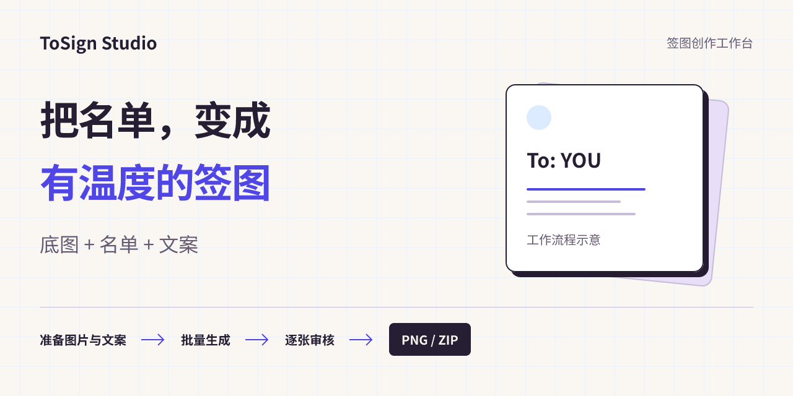
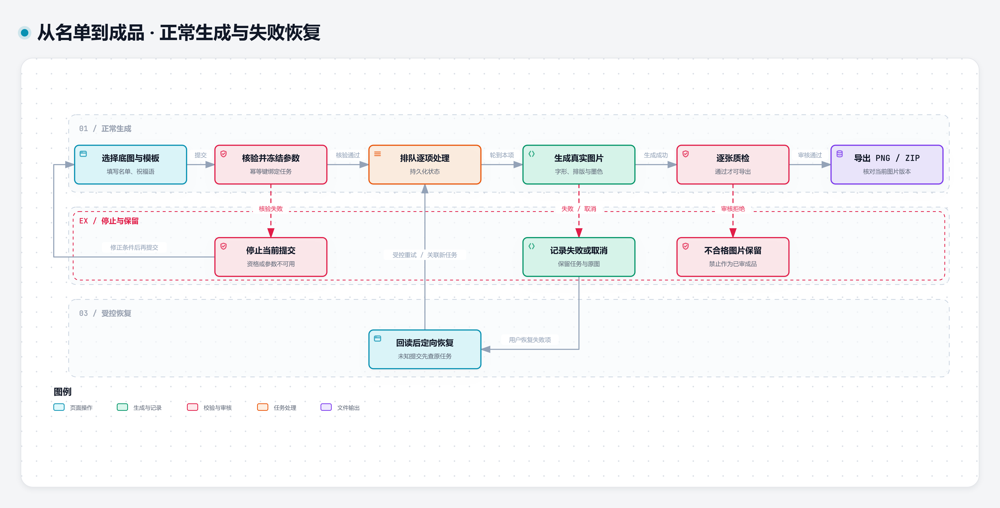
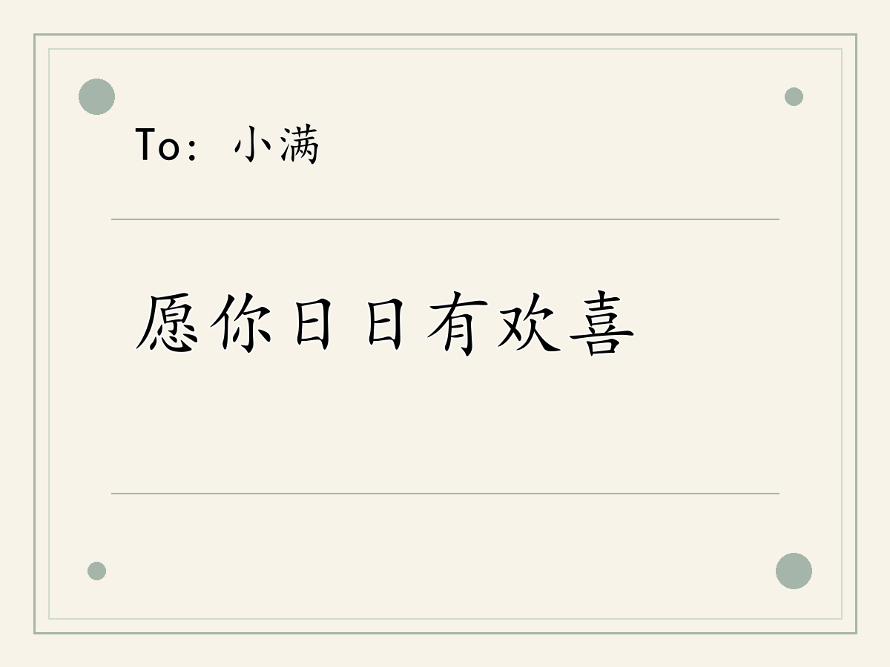
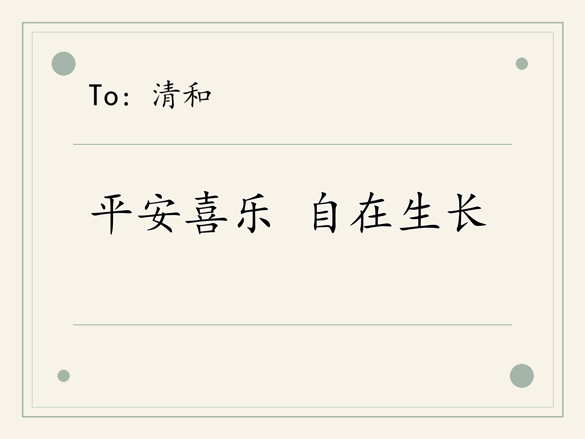
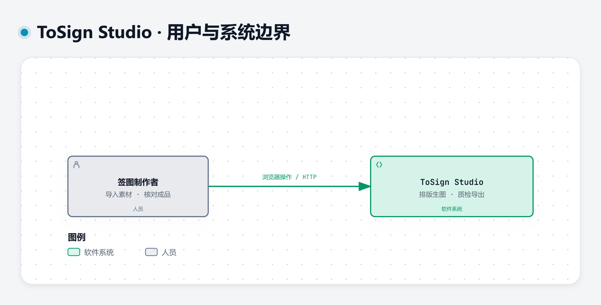
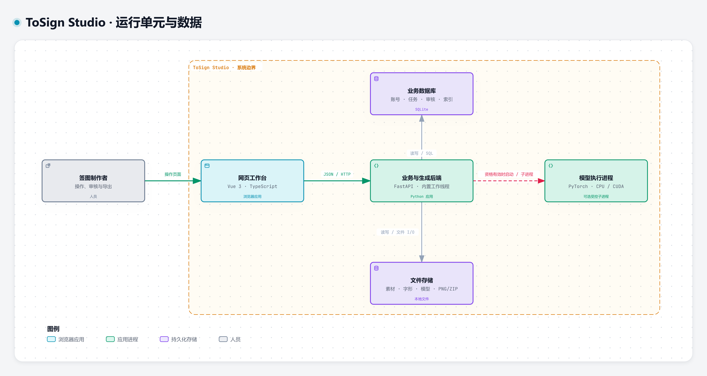

<h1 align="center">ToSign Studio</h1>

<p align="center">把一张底图和一份名单，制作成可以逐张审核、批量交付的专属签图。</p>

<p align="center"></p>

给多人制作带姓名和祝福语的图片时，不必在图片编辑器里反复复制、改名和保存。ToSign Studio 将底图、文字区域、名单、字形来源与审核放在同一套本地工作台中，适合签图创作者、活动组织者和需要重复出图的小团队。

**现在可以先用系统字体完成生成与导出。** 个人手写风格另有素材提取、训练、评估和发布链路；已有新模型完成训练，但尚未完成完整评估与正式发布。

## 页内索引

[工作流程](#workflow) · [功能与真实效果](#features) · [快速开始](#start) · [页面操作](#use) · [系统架构](#architecture) · [技术与设计](#engineering) · [故障恢复与限制](#limits) · [许可证](#license)

<a name="workflow"></a>
## 从底图到可交付图片

先在图库准备并审核底图，标出姓名、文案等文字区域，再把名单送入批量工作台。系统记录每项任务使用的底图、字形与排版设置，生成后进入逐张质检。确认成品后，才能下载对应 PNG 或整批 ZIP。



失败项保留原记录，可以定向重试；请求结果不明时先查回任务，不应重复提交整批。取消请求也需要读取最终状态。审核绑定具体图片版本，生成了新版本或文件被改动，旧审核不能直接沿用。

可选：[交互流程图](assets/diagrams/workflow.html) · [矢量图](assets/diagrams/workflow.svg) · [可编辑源](assets/diagrams/workflow.json)。交互 HTML 需下载后在浏览器打开，GitHub 首页显示的是上面的静态图。

<a name="features"></a>
## 能做什么，能得到什么

### 一份名单，分别生成姓名与祝福语

下图由仓库中的演示程序调用真实 API 生成，使用原创几何底图和本机系统楷体；没有使用私人照片、手写模型或合成产品截图。



另一条输入为“清和 / 平安喜乐 自在生长”，同一模板生成独立图片：



本次验证覆盖：全新账号、两张真实生成、相同幂等键返回同一任务、未审核导出被拒绝、测试审核后导出、PNG 与 ZIP 成员字节一致，以及重启后状态和文件保持一致。演示中的审核是明确标注的自动 API 测试操作，不代表真人审美验收或个人模型质量通过。

[查看这次使用的空白底图](assets/demo/background.png)。可按下方命令在自己的空目录重新生成，不需要已有数据库或私人素材。

### 制作、整理和交付

| 场景 | 可以进行的操作 | 得到的结果 |
|---|---|---|
| 多人签图 | 准备底图、标注文字区域、输入不同姓名与文案 | 独立图片、逐项状态和审核后的整批 ZIP |
| 重复使用版式 | 保存姓名、文案和署名的区域，调整字号、间距与墨色 | 任务冻结的版式与字形来源，便于复查 |
| 从原图积累手写材料 | 在带 To 签的参考图上检测候选区域、分离字形、修整并确认 | 可追溯的字形样本，原始图片保留 |
| 个人风格训练 | 审核样本、生成 S03 数据快照、查看训练与评估状态 | 与数据和模型身份绑定的训练记录；发布需另过质量门 |
| 日常管理 | 保存祝福语和预设，管理账户、查看用量与审计 | 可复用文案、用户隔离记录；备份/用户导出入口也已实现 |

批量接口最多接受 200 项输入，这只是输入上限，**不是一次 200 张的性能承诺**。备份与完整个人训练发布链没有在本次干净安装中端到端验收。

### 与逐张编辑有什么区别

普通图片编辑器适合自由创作；这里更关注一张底图需要重复做给很多人的情况。名单与文案成为任务输入，模板定义区域，字形来源与排版参数随任务保存，审核和导出绑定具体成品。它还能把签图原图中的字形整理为训练材料，但提取功能不等同于通用 OCR：字符内容和笔画完整性仍需确认。

<a name="start"></a>
## 快速开始：先跑系统字体生成

本源码包提供不含私人资产的开发体验。以下步骤在 **Windows、E 盘、Python 3.12.13、Node.js 24.18.0、npm 11.16.0** 上验证；其他系统未验证。准备 Python 3.12；Node.js 的声明范围是 `^20.19.0 || ^22.12.0 || >=24.0.0`，首次体验建议使用上面的实测版本。安装需要访问 Python/npm 软件源。

系统字体演示还需要本机已有 `Windows/Fonts/simkai.ttf`（楷体）。字体文件不随包分发；缺少它时不要把其他字体伪装成这次的演示效果。首次体验不需要 PyTorch、CUDA 或模型权重。

### 1. 安装并构建

将源码解压到 E 盘，打开 PowerShell，**进入解压后的项目根目录**。以下命令都从该目录执行；所有数据使用新建目录。

```powershell
py -3.12 -m venv .venv
$python = (Resolve-Path .venv/Scripts/python.exe).Path
& $python -m pip install -r requirements-base-app.lock
npm --prefix frontend ci
npm --prefix frontend run build
```

预期：Python 依赖安装成功，前端类型检查通过，生成 `frontend/dist/index.html`。源码不含预装依赖或构建目录。若使用离线依赖，必须匹配锁文件；不能用已有依赖目录代替一次全新安装验证。

### 2. 先做一次可复现的生成与导出

```powershell
$demo = Join-Path (Get-Location).Path 'demo-output'
& $python showcase/demo.py --output $demo --port 18916
```

`demo-output` 必须不存在或为空，端口必须空闲。程序会创建独立数据库、一次性邀请码和随机测试账户，启动本地服务，用两条名单生成图片，检查审核门、导出与重启恢复，然后关闭自己的服务。它不会使用现有用户数据，也不执行 GPU 训练。

预期看到 **20 checks passed**，并得到：

- `demo-output/base-original.png`：原创底图。
- `demo-output/render-1.png`、`render-2.png`：两张实际生成图片。
- `demo-output/outputs.zip`：包含与成品字节一致的两个 PNG。
- `demo-output/result.json`：本次检查项目和输出摘要。

重复演示时选择另一个空目录，保留上一次结果。

### 3. 启动自己的页面工作台

继续在同一个 PowerShell、同一个项目目录执行。下面是另一套新数据，不复用自动演示账号。

```powershell
$data = Join-Path (Get-Location).Path 'local-data'
$env:YY_DB_URL = 'sqlite:///' + (Join-Path $data 'studio.db').Replace('\', '/')
$env:YY_STORAGE_ROOT = Join-Path $data 'storage'
& $python showcase/serve.py --init-data
& $python installer/first_invite.py FIRST-RUN --uses 1 --yes
& $python showcase/serve.py --port 18916
```

必须先执行 `--init-data`，再创建邀请码；启动器会拒绝接管未登记的非空数据库或素材目录。`FIRST-RUN` 仅用于这个本地新实例的一次注册，不是通用账号密码。

打开 [本机注册页面](http://127.0.0.1:18916/register)，自己设置账户和密码，使用刚创建的邀请码注册。首个账户是本实例管理员，首次登录需修改密码，再进入工作台。关闭服务用当前终端的 `Ctrl+C`；下次使用相同两个数据路径直接启动，无须重建邀请码或数据库。启动器固定只监听本机回环地址。

### 4. 运行验证

```powershell
& $python -m pip install -r requirements-verification.txt
& $python -m pytest tests/showcase -q
```

默认执行启动与数据保护测试，完整 API 演示测试默认跳过。构建完成后，可显式启用它：

```powershell
$env:YY_SHOWCASE_E2E = '1'
& $python -m pytest tests/showcase -q --basetemp test-output
Remove-Item Env:YY_SHOWCASE_E2E
```

`test-output` 应为新测试目录，不要指向用户数据。测试通过不代表私人手写模型已经发布。

<a name="use"></a>
## 在页面中制作第一张图

1. 进入“图库”上传你有权使用的底图；管理员确认后才能正式生成。可以先使用本页演示的空白底图。
2. 打开标注页，分别划定姓名和文案区域并保存模板。让两个区域分开，先用短文案检查，避免相互覆盖。
3. 进入“批量生成”，选底图、对应模板与“系统字体”，填写一条姓名和祝福语。无个人模型的干净安装请先用系统字体。
4. 先预览，再正式生成。预览草稿不能当正式成品导出。
5. 在审核页查看实际图片，确认文字、位置和笔画后通过质检。只有已完成且通过审核的图片才能导出 PNG；多项成品可导出 ZIP。

图库为 `/assets`，批量工作台为 `/batch`，字体与训练为 `/styles`、`/training`，祝福语为 `/blessings`，个人设置为 `/me`。审计与备份页面需要管理员权限。

训练材料应来自参考图的文字提取与正式审核。不能把“原图已上传”当成“样本已准备好”，也不能把完成训练当成完成发布。自助训练的顺序是：参考图 → 字形提取/修整 → 正式样本审核 → S03 快照 → 训练 → 真实效果评估 → 必需确认 → 发布后供生成选择。

<a name="architecture"></a>
## 系统怎样运行

### 使用者与系统边界



用户通过本地浏览器操作。素材、任务和输出保存在本地；可选模型与字体必须单独具备合法来源和执行条件。下方运行单元图中的可选模型路径不表示源码包自带已发布模型。

### 页面、服务与存储



这是一个**本地模块化单体**：Vue 页面通过 HTTP 调用同一 FastAPI 应用，各业务域在该进程内协作。SQLAlchemy/SQLite 保存账户、任务、审核与文件索引；本地文件保存原图、字形、快照和输出。生成等工作由进程内后台线程处理，较重的个人模型任务使用独立 Python 子进程及资源租约。浏览器不直接访问数据库。

首次体验启动器将前端构建与 API 放在同一端口，明确禁用个人训练 worker；配置中的 GPU 锁路径仅满足源码导入时的资源配置检查，不创建锁、不授权模型执行。这里没有 Redis、Celery 或独立消息队列服务。

可选交互视图：[系统边界](assets/diagrams/context.html)、[运行单元](assets/diagrams/containers.html)。
可编辑与语义源：[Context JSON](assets/diagrams/context.json)、[Container JSON](assets/diagrams/containers.json)、[完整图形参考](docs/architecture/index.md)。核心关系已在本页展开，无须打开参考页才能理解。

<a name="engineering"></a>
## 技术选型与关键设计

| 技术 | 在这个项目中的职责 |
|---|---|
| Vue 3、TypeScript、Vue Router、Pinia | 图库、标注、训练、批量、审核页面；路由权限与会话状态 |
| Vite、Tailwind CSS | 前端构建、样式与工作台视觉 |
| FastAPI、Pydantic、Uvicorn | HTTP 接口、请求校验、登录与本地服务 |
| SQLAlchemy、SQLite | 账户归属、素材索引、任务/审核状态和恢复记录 |
| Pillow、NumPy、fontTools | 图片处理、颜色/字形处理、字体覆盖与排版 |
| 可选 PyTorch、CUDA、FontDiffuser 适配 | 个人手写风格的训练与推理；不参与系统字体首次体验 |
| pytest、Vitest | 后端/集成辅助测试与前端行为测试；当前安装验证范围见上文 |

**可查回的任务。** 创建请求支持幂等键，遇到响应中断先读取任务，减少重复生成。失败项可保留原版本并单独恢复。任务创建时冻结重要输入，不能把后改的风格冒充原任务。

**审核针对具体成品。** 状态、图片版本与字节身份共同参与导出判断；文件变动或版本重做不能继承旧通过。下载再次核对导出文件，ZIP 并非随意打包磁盘目录。

**字形来源可区分。** 系统字体、导入的旧个人模型和新训练模型各有身份；中文、拉丁字母、数字及标点可分别指定来源。经典手写 V3 的组合包含旧中文模型、Caveat 600 与 Noto face 2；它依赖包外的准确字体/模型及独立执行资格。不能因回退到系统字体就宣称个人风格推理成功。

**训练数据有绑定。** S03 是固定训练数据快照；模型与数据、源码及执行环境分别核验，AI 授权审核与真人确认独立记录。资格验证、训练 loss 与发布质量是不同结论。

源码入口：`app/main.py` 注册业务路由，`app/domains/` 按图库、提取、训练、生成、导出等领域组织，`engine/style/` 包含可选模型执行协议，`frontend/src/pages/` 对应真实页面。`showcase/` 只提供本源码分发的隔离启动与演示辅助，不替换业务实现。

<a name="limits"></a>
## 故障恢复与当前边界

| 现象 | 应先检查什么 |
|---|---|
| 启动拒绝现有数据目录 | 检查两个绝对路径；首次使用选全新目录并先 `--init-data`。不要删除原数据来绕过保护 |
| 页面能开但无法正式生成 | 核对底图/模板审核、字体覆盖、所选风格能力与来源要求；草稿成功不等于正式生成可用 |
| 创建任务一直等待或断线 | 先查任务状态与幂等回执；不要连点创建整批。模型初始化/冷字推理可能很慢 |
| 字体缺失或模板文字重叠 | 确认本地字体来源；检查画布尺寸与模板绑定，分开区域并用真实预览复核 |
| 已完成却导出被拒绝 | 逐项核对审核、文件是否变更；恢复失败项后重新审核相应版本 |
| 安装源连接失败 | 检查实际软件源、网络/代理与锁文件。可使用匹配的本地 wheel/cache，不跳过依赖完整性检查 |

在批量工作台，存在未确认提交时用“选择恢复此提交”选回记录，再用“重试原提交”沿用其身份；不要新建整批。已进入审核页时，“重试读取”更新任务，“重试此项”只处理当前可恢复项，“确认并恢复原重试”用于重试结果未知的情况。取消状态未确认时可用“读取原任务取消状态”。这些按钮按当前状态出现；浏览器本地存储不可用时先恢复存储，再读取已有记录。

- **新模型尚未正式可用。** 现有 GPU2 模型已完成 8 epoch / 192 updates，但完整效果评估、必要审核和发布未完成；不随源码提供权重。完整“自助训练→新模型发布→页面生成”仍待验收。
- **旧 V3 冷字性能仍有风险。** 存在未缓存中文接近执行预算的历史运行；不能用缓存命中或系统字体演示证明所有文案可靠。当前包不承诺冷字时延。
- **提取需要人工判断。** 颜色和连通区域候选不保证字的语义、分割或笔画完整，不能替代真实审核。
- **模板需要对应画布与字体策略。** 不能保证任意模板自动适合任意风格或长文案。已有重叠用例，首次从分离区域的短文案开始。
- **来源与平台有边界。** 本地演示只验证 Windows/E 盘；不包含字体、模型、训练集或授权密钥，不提供绕过资格的方法。可选 FontDiffuser 研究依赖的现有配置不授予再分发或商业使用权。
- **依赖仍需维护。** 本次 `npm ci` 的锁文件有 2 项中危、1 项高危告警，涉及开发依赖链；未为消除告警而盲目升级。不应把此本地开发入口直接暴露到公网。
- 当前实现不包括抖音群/评论区自动监听与回复。没有公开在线演示、跨平台安装保证或已验证的 200 张吞吐指标。

<a name="license"></a>
## 许可证与素材

项目自有源码采用 **Apache-2.0**，完整条款见 [LICENSE](LICENSE) 与 [NOTICE](NOTICE)。第三方依赖保留各自许可证；此授权不覆盖包外模型、Windows 字体、训练材料、用户照片或第三方图像。

本页底图由演示代码绘制，示例成品由真实 API 输出。头图和图形生成工具的必要许可分别保存在 [图像工具许可](licenses/showcase/snap-x/LICENSE) 与 [架构图及嵌入字体许可](assets/diagrams/licenses/NOTICE.md)。原项目用户材料和私人运行记录未进入本分发。
